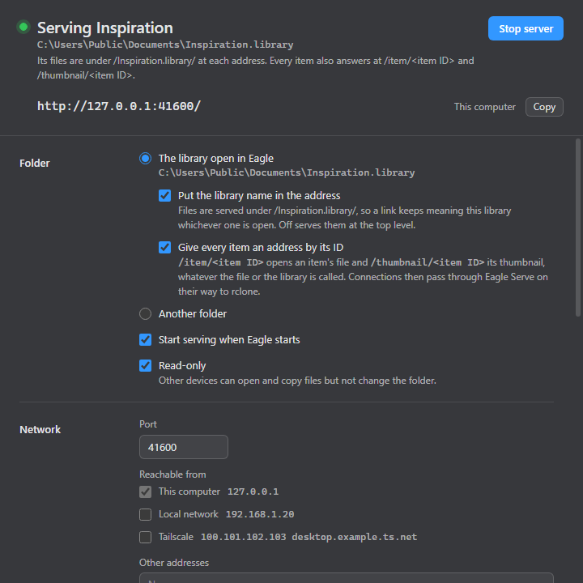

# Eagle Serve 📡

**Eagle Serve** is a background-service plugin for [Eagle](https://eagle.cool) that serves the library you have open over **WebDAV**. It starts with Eagle, runs [rclone](https://rclone.org/) underneath, and is configured entirely from a window inside Eagle: the port, which networks can reach it (this computer, your LAN, your Tailscale network), HTTPS, sign-in, and which devices are allowed to connect.

It is the plugin form of [webdav-server-kit](https://github.com/coreyx/webdav-server-kit): the same rclone setup and the same options, without the config file, Python, or start/stop scripts.



*The window with item links turned on, serving on a non-default port.*

---

## ✨ Features

- **Starts with Eagle**: runs as a background service and serves the open library under its own folder name (`/Main.library/…`). Switch libraries in Eagle and the server follows.
- **Pick who can reach it**: always available on this computer (`127.0.0.1`); tick **Local network** and **Tailscale** to also listen on those addresses, or add any other address by hand.
- **Follows your network**: addresses that come and go (Wi-Fi reconnecting, Tailscale starting late) are picked up automatically and the server rebinds.
- **HTTPS**: use your own certificate and key, or generate a self-signed one in the window. No OpenSSL needed.
- **Sign-in**: usernames and passwords stored as bcrypt hashes in an `htpasswd` file. Add and remove users while the server is running.
- **Allowed devices**: limit connections to `self`, specific IPs, CIDR ranges, or device names. Everything else is disconnected before it reaches rclone.
- **Read-only by default**, with a configurable folder listing cache and symbolic link support.
- **rclone handled for you**: finds an installed rclone, or downloads the official build (checksum-verified) with one click.
- **Item links by ID** (optional): `/item/<item ID>` opens an item's file and `/thumbnail/<item ID>` its thumbnail, so a link survives the item or the library being renamed.
- **Native look**: follows all six Eagle themes.

---

## 📋 Requirements

- **Eagle 4** (the plugin runs inside Eagle's Electron 22 / Node 16 runtime).
- **rclone 1.61 or newer**. If it is not installed, the window offers to download it. To install it yourself instead:
  ```cmd
  winget install Rclone.Rclone
  ```
  ```bash
  brew install rclone
  ```

Developed and tested on Windows. The macOS code paths (rclone lookup and download, data folder, Tailscale detection) are in place but have not been run on a Mac yet.

---

## 🚀 Installation

### Option 1: Developer Mode (Recommended for testing & development)
1. Clone this repository and install its one runtime dependency:
   ```bash
   git clone https://github.com/coreyx/eagle-serve.git
   cd eagle-serve
   pnpm install
   ```
2. Open **Eagle** and go to the plugin panel.
3. Choose **Developer options > Import Local Project** and select the `eagle-serve` folder.
4. Open **Eagle Serve** from the plugin list to see the server status and settings.

### Option 2: Eagle Plugin Package
Double-click an `eagle-serve-<version>.eagleplugin` package (from the [releases page](https://github.com/coreyx/eagle-serve/releases), or built as described below) to install it into Eagle.

---

## 🖥️ Using Eagle Serve

Once installed, the server starts whenever Eagle does. Open **Eagle Serve** from the plugin list to see what it is doing:

- The top of the window shows whether the server is running, the folder it is serving, and **every address it can be reached at**, each with a **Copy** button.
- **Stop server** / **Start server** controls it by hand. A server you stop stays stopped until you start it again or restart Eagle.
- Changes to the settings wait in an **Unsaved changes** bar until you choose **Save and restart**.

### Connecting from another device

Any WebDAV client works. Use one of the addresses shown in the window:

| Client | Where to enter the address |
| --- | --- |
| macOS Finder | **Go > Connect to Server…** |
| Windows Explorer | **This PC > Map network drive** |
| Apps with a WebDAV option | Their server or URL field |
| rclone | `rclone config` with the `webdav` backend |
| curl | `curl -u user:password https://host:41599/metadata.json` |

**Connecting by name.** With **Local network** or **Tailscale** on, the list includes this computer's name (for example `http://desktop:41599/`). You do not need to add the name under **Other addresses**: a name is looked up by the device that connects, and it leads to an address the server is already listening on. Tailscale devices resolve the short name through MagicDNS. On a plain local network it depends on the device; Apple devices usually need `desktop.local`.

### Addresses inside the library

The library is served under its folder name, so for a library called `Main`:

```
https://host:41599/                                         lists Main.library
https://host:41599/Main.library/metadata.json               the library's metadata
https://host:41599/Main.library/images/<item id>.info/<file>  one item's file
```

This is the layout [obsidian-eagle-bridge](https://github.com/coreyx/obsidian-eagle-bridge) builds its links from: set its **Custom URL prefix** to the server address (`https://host:41599`) and it adds the rest. Because the library name is part of every link, a link keeps meaning the same library after you switch libraries in Eagle; while another library is open it returns 404 instead of looking in the wrong one.

Turn off **Put the library name in the address** to serve the library at the top level instead (`https://host:41599/metadata.json`). A folder chosen with **Another folder** is always served at the top level.

### Item links by ID

An address built from the file name breaks when the item is renamed in Eagle, and one that carries the library name breaks when the library is renamed. Turn on **Give every item an address by its ID** to also get an address that depends on neither:

```
https://host:41599/item/MV63BVOWOZLV6
https://host:41599/item/MV63BVOWOZLV6/any-name-you-like.png
https://host:41599/item?id=MV63BVOWOZLV6
```

All three open the item's original file. The second form ignores the name after the ID; it is there for readability and for clients that look at the extension. The third matches the shape of Eagle's own item links (`http://localhost:41595/item?id=…`), which open the item in Eagle rather than returning its file.

Replace `item` with `thumbnail` for the small preview Eagle keeps beside the file, in the same three forms:

```
https://host:41599/thumbnail/MV63BVOWOZLV6
```

A thumbnail is always a PNG. Eagle does not make one for images that are already small, and for those the thumbnail address returns the file itself, so it is safe to use for every item.

The ID is looked up in the library being served each time, from the item's `images/<ID>.info/metadata.json`, so it follows renames as they happen. Things to know:

- Item links are read-only (`GET` and `HEAD`) and need the same sign-in as everything else.
- An ID from a library that is not the one open in Eagle returns 404.
- After a rename, the new file can take up to the folder listing cache time (5 seconds by default) to appear.
- With this on, connections go through a small HTTP layer inside the plugin on their way to rclone (see [How It Works](#-how-it-works)). The ordinary WebDAV addresses keep working unchanged.
- There is no right-click entry in Eagle for copying an item's link yet. [docs/context-menu-findings.md](docs/context-menu-findings.md) explains what Eagle allows and what building one would take.

> **Writing to a library from outside Eagle.** **Read-only** is on by default. With it off, connected devices can change and delete files in the library, including deleting the whole library folder in one request, and Eagle does not expect files to change underneath it. Turn it off only if you have a specific reason to write.

---

## ⚙️ Settings

Every option of webdav-server-kit's `config.yaml` has a control in the window.

| Setting | What it does | Default | `config.yaml` equivalent |
| --- | --- | --- | --- |
| **Folder** | Serve the library open in Eagle, or another folder you choose. | The open library | `storage_path` |
| **Put the library name in the address** | Serve the open library as `/<Name>.library/` instead of at the top level. | On | — |
| **Give every item an address by its ID** | Also answer at `/item/<item ID>` and `/thumbnail/<item ID>`, whatever the file or library is called. | Off | — |
| **Start serving when Eagle starts** | Start the server automatically. | On | — |
| **Read-only** | Other devices can read but not change the folder. | On | — |
| **Port** | TCP port to listen on. | `41599` | `port` |
| **Reachable from** | `127.0.0.1` always; optionally the LAN and Tailscale addresses of this computer. | This computer only | `host` |
| **Other addresses** | Extra addresses or names to listen on. A name listens on every address it resolves to. `0.0.0.0` listens on every interface. | None | `host` |
| **HTTPS** | Certificate and private key (PEM) for TLS. | Off | `cert_path`, `key_path` |
| **Sign-in** | Require a username and password (HTTP Basic, bcrypt `htpasswd`). | Off | `htpasswd_path` |
| **Allowed devices** | Only accept connections from the listed clients. | Off (`self` when on) | `allowed_clients` |
| **Folder listing cache** | How long rclone caches a folder's contents. | `5s` | `dir_cache_time` |
| **Follow symbolic links** | Serve the targets of symlinks (`rclone -L`). | On | always on |
| **rclone** | Path to the rclone program. Empty means find it automatically. | Automatic | — |

The default port is `41599` rather than 8080 so it sits beside Eagle's own local ports (`41595`, and `41596` for the MCP Server plugin) instead of colliding with development servers.

### Where settings are stored

| Platform | Folder |
| --- | --- |
| Windows | `%APPDATA%\eagle-serve` |
| macOS | `~/Library/Application Support/eagle-serve` |

It holds `config.json`, the `htpasswd` file, generated certificates (`certs/`), a downloaded rclone (`bin/`) and `server.pid`. **Advanced > Open settings folder** opens it.

### Exporting and importing settings

**Advanced > Export settings…** writes every setting on the page to a JSON file, and **Import settings…** loads one back, to copy a setup to another computer or keep a backup.

- An import fills in the form and waits in the **Unsaved changes** bar. Nothing takes effect until you choose **Save and restart**, and **Discard** puts the current settings back.
- The file holds the settings only. Users (the `htpasswd` file) and certificate files are not included; copy them from the settings folder if you need them. Certificate and rclone paths are exported as written, so check them after importing on another computer.
- Settings the file leaves out get their defaults, and a plain `config.json` copied from the settings folder imports too. A file with a value of the wrong kind is refused with a message naming the setting.

---

## 🔒 HTTPS

Turn on **Encrypt connections with HTTPS** and either browse to an existing PEM certificate and key, or open **Generate a self-signed certificate**.

The generator pre-fills every name the server is reached by: `localhost`, `127.0.0.1`, `::1`, the computer name (plain and with `.local`), its LAN and Tailscale addresses, and its Tailscale MagicDNS name. Add anything else you will type into a client. Clients ignore the certificate's Common Name and only check these Subject Alternative Names, so an address that is missing from the list will be rejected.

The certificate is a 4096-bit RSA key signed with SHA-256, valid for one year, written to `certs/server.crt` and `certs/server.key` in the settings folder. The window shows what the current certificate covers and when it expires.

### Trusting a self-signed certificate

Each device warns about a self-signed certificate until you install `server.crt` there as trusted.

**Windows**
```cmd
certutil -addstore -user Root server.crt
```

**macOS**
```bash
sudo security add-trusted-cert -d -r trustRoot -k /Library/Keychains/System.keychain server.crt
```

**iOS / iPadOS**: send `server.crt` to the device, install the profile in **Settings**, then enable it under **Settings > General > About > Certificate Trust Settings**.

**Linux (Debian / Ubuntu)**
```bash
sudo cp server.crt /usr/local/share/ca-certificates/eagle-serve.crt
sudo update-ca-certificates
```

Restart the client app afterwards so it re-reads the trust store.

---

## 🔑 Sign-in

Turn on **Require a username and password**, then add users in the window. Passwords are hashed with bcrypt (cost 12) and only the hash is written to the `htpasswd` file. Adding or removing a user takes effect immediately, without a restart.

The server refuses to start with sign-in on and no users, rather than quietly serving nothing.

HTTP Basic authentication sends credentials with every request, so pair it with **HTTPS** whenever the server is reachable beyond this computer. The window warns when it is not.

---

## 🛡️ Allowed devices

Turn on **Only accept connections from these devices** and list one rule per line:

| Rule | Matches |
| --- | --- |
| `self` | Any connection from this computer, on any of its addresses |
| `192.168.1.25` | One IP address (IPv4 or IPv6) |
| `192.168.1.0/24` | A CIDR range |
| `macbook-air` | A device name, resolved by forward and reverse DNS (works with Tailscale MagicDNS names) |

When this is on, rclone listens on a private loopback port and a small TCP filter owns the public port. Allowed clients are forwarded byte-for-byte (TLS and sign-in still happen in rclone); everyone else is disconnected immediately, and each refusal is written to the log.

**`self` or `127.0.0.1`?** A connection to `https://127.0.0.1:41599` arrives from `127.0.0.1`, but a connection from this computer to its own LAN address or hostname arrives from that LAN address. `self` covers both, so prefer it over listing `127.0.0.1`.

---

## 🔧 How It Works

- **Service lifecycle**: `manifest.json` sets `serviceMode`, so Eagle creates the plugin window (hidden) at launch. The window's script starts the server; the window itself is only the status and settings view.
- **rclone**: the plugin runs `rclone serve webdav <folder> --addr <address>:<port> …` as a child process with one `--addr` per address, no rclone config file, and captures its output for the **Log** section.
- **Staying in sync**: every 10 seconds, and whenever Eagle reports a library switch, the plugin compares the open library and this computer's addresses with what the server is bound to, and restarts it if they differ.
- **Clean shutdown**: rclone is stopped when Eagle exits. Its PID is also recorded in `server.pid`, so if Eagle is killed and leaves rclone behind, the next launch stops the leftover process (after checking that the PID really is rclone) before starting a new one.
- **A port that is taken** is reported in the window before rclone is launched.
- **Item links**: when they are on, rclone listens on a private loopback port over plain HTTP and the plugin's gateway owns the public port. The gateway terminates HTTPS, applies the allowed-devices check before the TLS handshake, rewrites `/item/<ID>` and `/thumbnail/<ID>` to the item's current file path, and forwards every request to rclone, which still does the sign-in and all the serving. When item links are off, the gateway is not in the path at all.

---

## 🧪 Testing

```bash
pnpm test
```

Runs `test/test-runner.js`, which covers the settings validation, network address classification, access rules (IPs, CIDR ranges, `self`, DNS names), `htpasswd` management, the certificate generator (checked with Node's own X.509 parser) and the zip extractor used for the rclone download.

With rclone available, it also runs integration tests against a real server on a temporary folder: upload, download, listing and delete, several listen addresses at once, a busy port, read-only mode, sign-in (including users added while running), HTTPS with a generated certificate, the access filter, library switching, item links by ID (including a rename, and with HTTPS, sign-in and allowed devices on), and stale-process cleanup.

The integration tests use an installed rclone, or the path in `EAGLE_SERVE_RCLONE`. To have the test run download rclone when none is found (this is what CI does):

```bash
EAGLE_SERVE_TEST_DOWNLOAD_RCLONE=1 pnpm test
```

---

## 📦 Building the Package

An `.eagleplugin` file is a plain zip of the plugin folder's contents, so the build script produces it directly:

```bash
pnpm install
pnpm build
```

This does two things:

1. **Stages** the runtime files (`manifest.json`, `index.html`, `logo.png`, `LICENSE`, `css/`, `js/`) and the production dependencies from `node_modules/` into `dist/eagle-serve/`, and sets `devTools` to `false` in the staged manifest. The folder is wiped and rebuilt on every run.
2. **Packs** that folder into `dist/eagle-serve-<version>.eagleplugin`, using the version from `manifest.json`.

The package has the same layout as the one Eagle's own **Pack Plugin** action writes. To pack with Eagle instead, import `dist/eagle-serve/` as a local project and use that action.

Runtime dependencies are copied as real files (pnpm is set to `nodeLinker: hoisted`, so there are no symlinks), and the build fails if a dependency is missing or would load from outside the staged folder.

### Publishing a release
The [Build and Release](.github/workflows/build.yml) GitHub Actions workflow runs `pnpm test` and `pnpm build` on every push to `main` and every pull request, and keeps the `.eagleplugin` as a workflow artifact. Pushing a version tag also publishes a GitHub release with the package attached:

```bash
git tag v1.0.0
git push origin v1.0.0
```

The tag must match the `version` in `manifest.json` (`v1.0.0` for `1.0.0`) or the workflow fails. The release body is that version's section of `RELEASE_NOTES.md`, falling back to `CHANGELOG.md`, then to GitHub's auto-generated notes.

---

## 📁 Repository Structure

```
eagle-serve/
├── .github/
│   └── workflows/
│       └── build.yml                 # CI: test, build .eagleplugin, publish release on version tags
├── assets/
│   └── screenshot.png                # Window screenshot for this README
├── docs/
│   └── context-menu-findings.md      # Why there is no right-click "Copy Eagle Serve Link" entry
├── css/
│   └── style.css                     # Native Eagle theming (6 themes) and layout
├── js/
│   ├── app.js                        # Window controller: lifecycle, status view, settings form
│   ├── config.js                     # Settings defaults, validation and config.json persistence
│   ├── network.js                    # LAN / Tailscale address discovery and bind address resolution
│   ├── access-filter.js              # Allowed-devices rules and the filtering TCP proxy
│   ├── gateway.js                    # Item links by ID: HTTP(S) front door that rewrites /item/<ID>
│   ├── htpasswd.js                   # bcrypt htpasswd user management
│   ├── cert.js                       # Self-signed certificate generator (pure Node crypto)
│   ├── rclone.js                     # rclone lookup, download and command line
│   └── server.js                     # Server controller: start, stop, restart, watch for changes
├── scripts/
│   ├── build-release.js              # Stages runtime files and packs the .eagleplugin into dist/
│   └── release-notes.js              # Prints one version's notes for the GitHub release body
├── test/
│   └── test-runner.js                # Automated unit & integration test suite
├── CHANGELOG.md                      # Keep a Changelog version history
├── RELEASE_NOTES.md                  # User-facing release notes
├── manifest.json                     # Eagle plugin manifest (service mode)
├── package.json                      # pnpm scripts (build, test) and the bcryptjs dependency
├── pnpm-lock.yaml                    # Locked dependency versions
├── pnpm-workspace.yaml               # pnpm settings (hoisted node_modules, no symlinks)
├── index.html                        # Window layout
└── README.md                         # Project documentation
```

---

## 📄 License

This project is licensed under the [MIT License](LICENSE).

It runs [rclone](https://rclone.org/) (MIT) as a separate program and bundles [bcryptjs](https://github.com/dcodeIO/bcrypt.js) (BSD-3-Clause) for password hashing.
